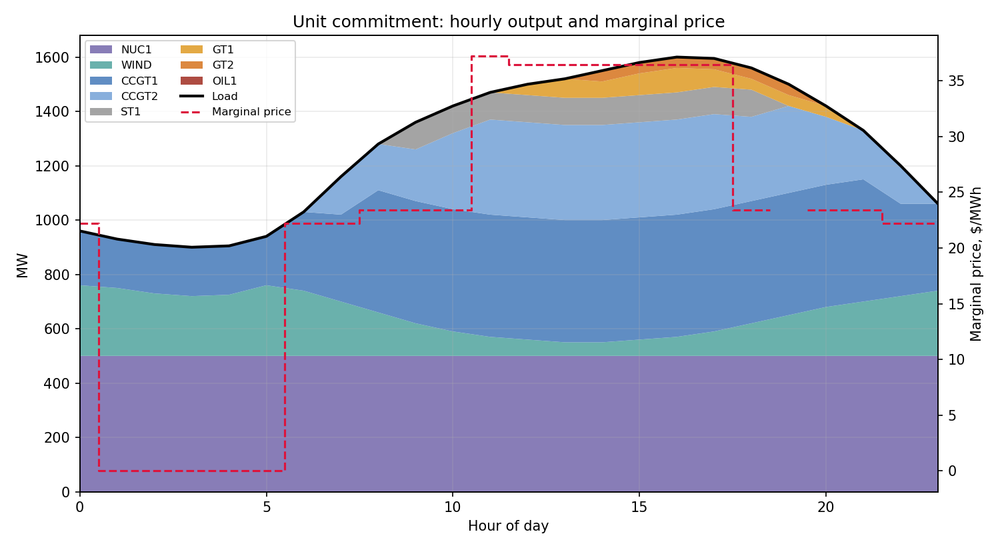
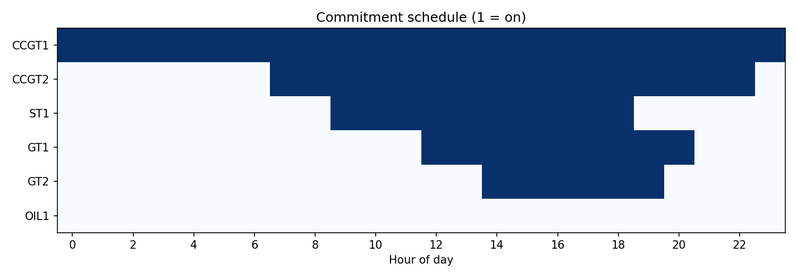
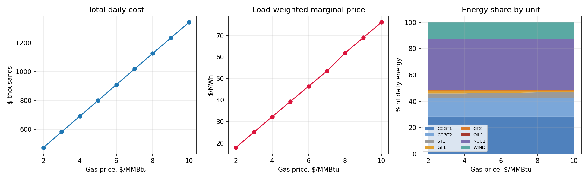

# Energy Dispatch and Unit-Commitment Optimization

A 24-hour economic dispatch (LP) and unit-commitment (MILP) model for a **stylized, invented** 8-unit power system, built in Python with Pyomo and the HiGHS solver. It answers the questions a power operator asks each day: which plants should run, how much should each produce, and what does one more megawatt cost?

> **Everything about the fleet is an assumption.** The units, heat rates, costs, load shape and wind profile are illustrative numbers I chose, not data from real plants. See the assumptions table below.

## What it does

1. **Economic dispatch (Phase 1):** minimize fuel and variable cost so that generation equals demand each hour. Checks that the result follows merit order and computes the system marginal price by re-solving with +1 MW of demand.
2. **Unit commitment (Phase 2):** adds on/off decisions with minimum output, start-up and no-load costs, minimum up/down times, ramp limits and a 10% reserve requirement. Every constraint is re-verified in code on the solved schedule.
3. **Sensitivity analysis (Phase 3):** gas price sweep from $2 to $10/MMBtu, a break-even check, a 2x wind scenario and a 15% reserve scenario.

## Repo layout

| Path | Contents |
|---|---|
| `data/` | `fleet.csv`, `load_24h.csv`, `wind_24h.csv` (the only inputs) |
| `src/data.py` | Reads the CSVs, computes marginal costs and break-even gas prices |
| `src/model.py` | Pyomo models for dispatch and unit commitment, solver wrapper |
| `src/analysis.py` | Constraint verification, marginal prices, sensitivity analysis, charts |
| `src/hello_world.py` | Two-generator solver check |
| `tests/test_model.py` | pytest suite |
| `run_all.py` | One command that reproduces every result and chart |
| `notebooks/demo.ipynb` | Walkthrough |
| `docs/` | Charts and tables written by `run_all.py` |

## How to run

```bash
python -m venv .venv && source .venv/bin/activate
pip install -r requirements.txt
python -m src.hello_world      # solver check: expect cheap=80 MW, expensive=20 MW, cost $2,600
pytest                         # tests
python run_all.py              # reproduces all results and charts into docs/
```

## Problem and formulation

**Sets:** units `g` (CCGT1, CCGT2, ST1, GT1, GT2, OIL1) and hours `t = 0..23`. Nuclear is a constant 500 MW at $8/MWh and sits outside the decision variables. Wind is a variable with availability `A[t]`, zero marginal cost, and may be curtailed.

**Marginal cost.** Gas units: `mc[g] = heat_rate[g] * gas_price + VOM[g]`. Oil peaker: fixed $190/MWh.

**Economic dispatch (LP).** Variables `p[g,t]` in `[0, Pmax[g]]` and `pw[t]` in `[0, A[t]]`.

```
minimize   sum over g,t of mc[g] * p[g,t]                 (+ constant nuclear cost)
subject to sum over g of p[g,t] + pw[t] + 500 = D[t]       for each hour t
```

**Unit commitment (MILP).** Adds binaries `u[g,t]` (on), `v[g,t]` (start-up), `w[g,t]` (shut-down).

```
minimize   sum over g,t of ( mc[g]*p[g,t] + noload[g]*u[g,t] + startup[g]*v[g,t] )

balance    sum_g p[g,t] + pw[t] + 500 = D[t]
limits     Pmin[g]*u[g,t] <= p[g,t] <= Pmax[g]*u[g,t]
state      u[g,t] - u[g,t-1] = v[g,t] - w[g,t]
min up     sum of v[g,tau] for tau in (t-UT[g]+1 .. t)  <=  u[g,t]
min down   sum of w[g,tau] for tau in (t-DT[g]+1 .. t)  <=  1 - u[g,t]
ramp up    p[g,t] - p[g,t-1] <= Ramp[g] + Pmax[g]*v[g,t]
ramp down  p[g,t-1] - p[g,t] <= Ramp[g] + Pmax[g]*w[g,t]
reserve    sum_g ( Pmax[g]*u[g,t] - p[g,t] ) >= 0.10 * D[t]
```

## Assumptions

| Unit | Type | Pmax MW | Pmin MW | Heat rate | VOM $/MWh | No-load $/h | Start-up $ | Min up/down h | Ramp MW/h |
|---|---|---|---|---|---|---|---|---|---|
| NUC1 | Nuclear, must-run | 500 | 500 | fixed $8/MWh | | | | | |
| CCGT1 | Combined cycle | 450 | 180 | 6.8 | 2.5 | 1,500 | 30,000 | 6 / 4 | 180 |
| CCGT2 | Combined cycle | 350 | 140 | 7.2 | 2.5 | 1,200 | 24,000 | 6 / 4 | 140 |
| ST1 | Older steam | 250 | 100 | 10.0 | **8.2** | 800 | 15,000 | 6 / 6 | 60 |
| GT1 | Gas peaker | 100 | 40 | 10.5 | 6.0 | 300 | 3,000 | 1 / 1 | 100 |
| GT2 | Gas peaker | 100 | 40 | 11.5 | 6.0 | 300 | 3,000 | 1 / 1 | 100 |
| OIL1 | Oil peaker | 80 | 30 | fixed $190/MWh | | 300 | 4,000 | 1 / 1 | 80 |
| WIND | Wind | up to 300 | 0 | $0/MWh | | | | | |

- **ST1 VOM is $8.20, not $4.** With a $4 VOM the merit order of the gas units never changes anywhere in the $2 to $10 sweep, so there would be no break-even to test. At $8.20, ST1 and GT1 have equal marginal cost at $4.40/MMBtu.
- Demand is a typical daily shape I wrote by hand, scaled to a 1,600 MW peak and 900 MW overnight low. Wind availability is a hand-written profile, windier overnight, between 50 and 290 MW.
- Base gas price is $2.90/MMBtu, the Henry Hub spot for the week ending Oct 2, 2026 from my [weekly market dashboard](https://github.com/anisharsingh/weekly-energy-market-dashboard).
- Starting state: nuclear and CCGT1 on (CCGT1 at 250 MW), everything else off. The starting state is assumed to satisfy min up/down times, so there is no carry-over from before hour 0.

## Results

Results from `python run_all.py` at a $2.90/MMBtu gas price and a 10% reserve requirement.

| Quantity | Value |
|---|---|
| Economic dispatch cost | $448,405 |
| Unit commitment cost | $570,701 |
| UC minus ED cost | $122,296 (27% higher) |
| Solve time / MIP gap / variables / constraints | 0.15 s / 0.0 / 600 / 1,056 |
| Start-ups in the UC schedule | 4 |
| Marginal unit at the peak hour | ST1 at $37.20/MWh (economic dispatch, hour 16) |
| Load-weighted marginal price at $2 gas / $10 gas | $17.90 / $76.25 per MWh |
| Break-even gas price, ST1 vs GT1 (by hand / model flips) | $4.40 / yes |
| 2x wind: curtailment and cost change | curtailment 210 to 2,075 MWh; cost $570,701 to $504,684 (-$66,017); starts 4 to 3 |
| 15% reserve: cost increase | +$23,690 (+4.2%); starts 4 to 5 |

**Economic dispatch: hourly output by unit, with the marginal price**


**Unit commitment: hourly output by unit, with the fixed-commitment price**



**Commitment schedule (1 = unit on)**



**Gas price sweep: total cost, load-weighted marginal price and energy share by unit**



**Why UC cost is at least ED cost:** the unit-commitment problem has every ED constraint plus more (minimum output, ramps, min up/down, reserve) and adds no-load and start-up costs, so its feasible set is smaller and its objective has extra terms. It can never be cheaper.

**Interpretation**

1. Unit commitment costs $570,701 against $448,405 for plain economic dispatch, about 27% more, which I put down to the no-load and start-up costs, minimum outputs, ramp limits and reserve requirement that dispatch ignores (I haven't measured how much each one contributes).
2. When I moved gas from $2 to $10 per MMBtu, the load-weighted marginal price went from $17.90 to $76.25 per MWh, roughly $7.30 for every dollar of gas, because gas units set the price in most hours.
3. The four start-ups and the 210 MWh of overnight wind I curtail don't change anywhere in that sweep, which makes sense because every dispatchable unit except the oil peaker is gas-fired, so their costs rise together and the oil peaker is never cheap enough to run.
4. ST1 and GT1 swap places in the merit order at $4.40 per MMBtu, which the formula (VOM difference divided by heat-rate difference) gives directly, and the dispatch model flips right there: at $4.60 ST1 supplies 1,485 MWh and GT1 supplies none.
5. Doubling wind capacity saves $66,017 but curtails 2,075 MWh instead of 210, because the nuclear plant and the committed gas units' minimum outputs leave little room for it overnight, and raising reserve from 10% to 15% costs $23,690 (4.2%) more and adds a start-up.

These are results for an invented fleet, so they show how the model behaves, not what a real system would do.

## Limitations

- Single bus: no transmission network, so no congestion or locational prices.
- No start-up or shut-down output trajectories; units jump to Pmin on start and leave from any level.
- Perfect foresight of demand and wind over the 24 hours.
- Stylized, invented fleet and hand-written demand and wind profiles.
- No terminal conditions: the model may shut units down at the end of the day because it does not value hour 24 onward.
- UC marginal prices are computed with the commitment fixed (an LP re-solve with +1 MW), so they exclude start-up and no-load effects. In hours where the reserve constraint has no slack, one more MW cannot be served by the committed units and the price is reported as missing.

## Next steps

- Feed a forecasted day from my load forecasting project in as demand and measure what a 3% forecast miss costs.
- Add a two-bus network with a transmission limit to see congestion and locational prices.
- Extend to a multi-day horizon with rolling windows.

## Reproducibility

Developed and run with Python 3.12.4, Pyomo 6.10.1, HiGHS (highspy) 1.15.1, pandas 2.2.2, numpy 1.26.4, matplotlib 3.8.4, pytest 7.4.4. The exact versions are pinned in `requirements.txt`.
